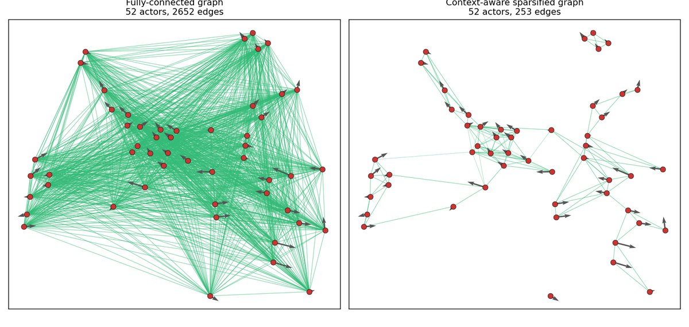

# Personal academic website — Amirreza M. Shebly

A static site (plain HTML + CSS, no build step, no dependencies) with an embedded
copy of the **Urban Interaction Lab** simulation.

```
.
├── index.html          # the whole page
├── css/style.css       # all styling
├── assets/             # portrait, CV (cv.pdf), publication/grant figures
├── sim/                # Urban Interaction Lab (embedded via <iframe>)
├── .nojekyll           # tells GitHub Pages to serve files as-is
└── README.md
```

---

## 1. Before you publish

Nothing left to fill in: the photo and the Scholar, GitHub and LinkedIn links are all in
place. To change the photo later, overwrite `assets/profile.jpg` with a 600×720 px
portrait crop.

The CV link in the header opens `assets/cv.pdf`. To update the CV, overwrite that
file with the new PDF and keep the name.

---

## 2. Preview it locally

```bash
cd <this folder>
python3 -m http.server 8000
```

Then open <http://localhost:8000>. (Opening `index.html` by double-clicking also
mostly works, but some browsers block the simulation `<iframe>` on `file://`
URLs — use the server.)

---

## 3. Publish to GitHub Pages

GitHub Pages serves a user site from a repository named **exactly**
`AmirMShebly.github.io` — this folder is already named to match.

**Step 1 — create the repository.** Go to <https://github.com/new>, name it
`AmirMShebly.github.io`, keep it **public**, and do *not* add a
README/licence/.gitignore (this folder already has the files).

**Step 2 — push:**

```bash
cd ~/AmirMShebly.github.io

git init -b main
git config user.name  "Amirreza M. Shebly"
git config user.email "amirreza@bilkent.edu.tr"

git add .
git commit -m "Personal academic website"

git remote add origin https://github.com/AmirMShebly/AmirMShebly.github.io.git
git push -u origin main
```

If you have not set up an SSH key or a credential helper, GitHub will ask for a
username and password at the push — the "password" must be a **personal access
token** (GitHub → Settings → Developer settings → Personal access tokens →
Fine-grained token with *Contents: read and write* on this repo), not your
account password.

**Step 3 — turn Pages on.** In the repository: **Settings → Pages → Build and
deployment → Source: _Deploy from a branch_ → Branch: `main`, folder `/ (root)`**
→ Save. For a `<username>.github.io` repo this is usually already the default.

The site goes live at <https://amirmshebly.github.io/> within a minute or two.
Every later `git push` redeploys it.

---

## 4. Editing the content later

Everything lives in `index.html` and is plainly commented. To **add a
publication**, copy one whole `<article class="pub"> … </article>` block, paste
it where you want it in the list, and change five things: the figure `src` and
its `alt` text, the title, the author line, the venue line, and the abstract.
A smaller paper goes under *Additional Publications*: copy one
`<div class="pub-compact"> … </div>` block (title, authors, venue only).

Status badges:

```html
<span class="tag tag-review">Under&nbsp;review</span>   <!-- amber -->
<span class="tag tag-accepted">Accepted</span>          <!-- green -->
```

`assets/grant-bilgem.jpg` (the sparsified-graph figure) is kept but **not
currently used** — the Grants section is deliberately text-only. To show it,
drop this inside the `<div class="grant">` block:

```html
<figure>
  
</figure>
```

Publication figures should be roughly 1200 px wide and under ~200 KB. To resize
one:

```bash
python3 -c "
from PIL import Image
im = Image.open('my_figure.png').convert('RGB')
w, h = im.size
im = im.resize((1200, int(h*1200/w)), Image.LANCZOS)
im.save('assets/pub-newpaper.jpg', 'JPEG', quality=86, optimize=True)
"
```

---

## 5. The simulation

`sim/` is a verbatim copy of the Urban Interaction Lab (`~/urban-interaction-lab`).
It is self-contained — plain HTML/CSS/JS on an HTML5 canvas, no libraries, no
network calls. If you improve the original, re-copy it:

```bash
cp -r ~/urban-interaction-lab/{index.html,js,css} ~/AmirMShebly.github.io/sim/
```

The `<iframe>` sits after Research Interests (the page order is About,
Publications, Research Interests, Demo, Education, Grants) and is
`loading="lazy"` so the simulation only starts running once it scrolls into
view. It is sized to sit flush with the text column: `.wrap-demo` (860 px, the same
as `.wrap`) and `.sim-frame` (440 px tall) in `css/style.css` — change those two
numbers to make the embed bigger or smaller.

Smaller screens: at 860 px and below the embed runs edge to edge, so the simulation
keeps its side-by-side layout down to 760 px. Below 760 px (phones) the simulation
stacks its panel under the intersection, the frame grows to `min(160vw, 640px)` tall
and the keyboard hints are hidden. On a touch screen a tap within 22 px of an agent
selects it, and its card appears at the top of the panel, right under the intersection.
